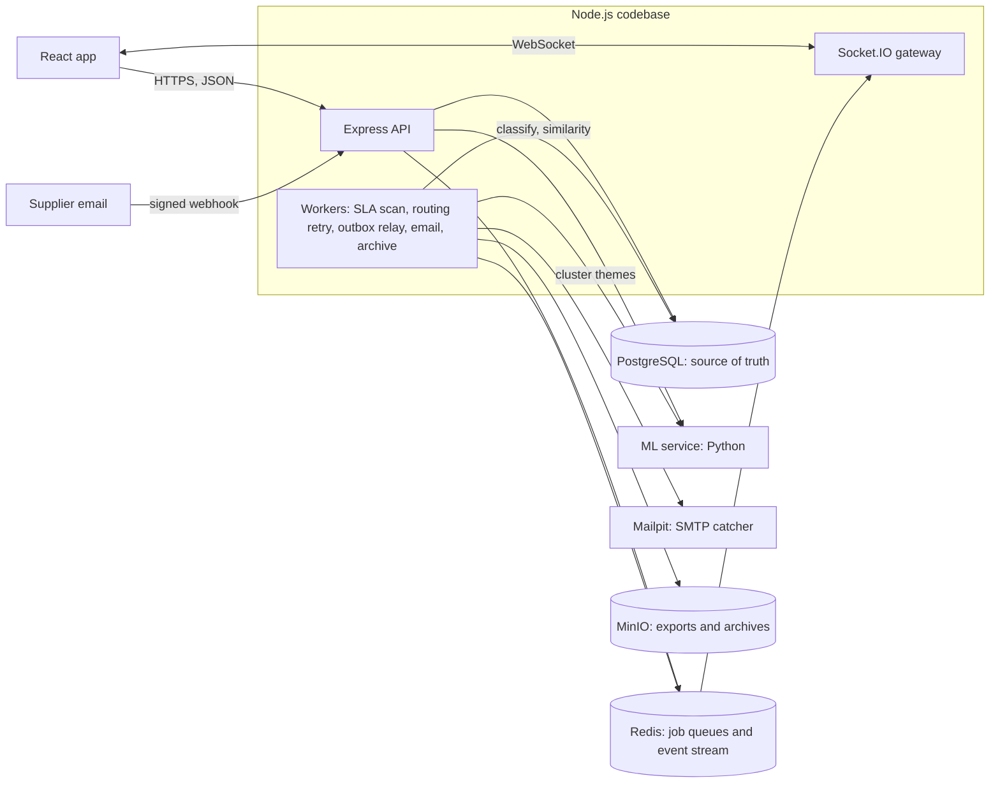
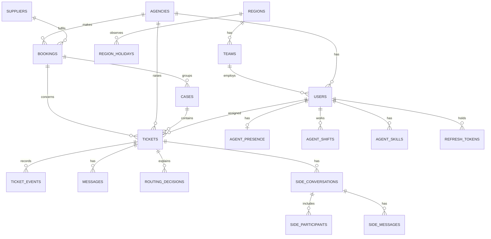
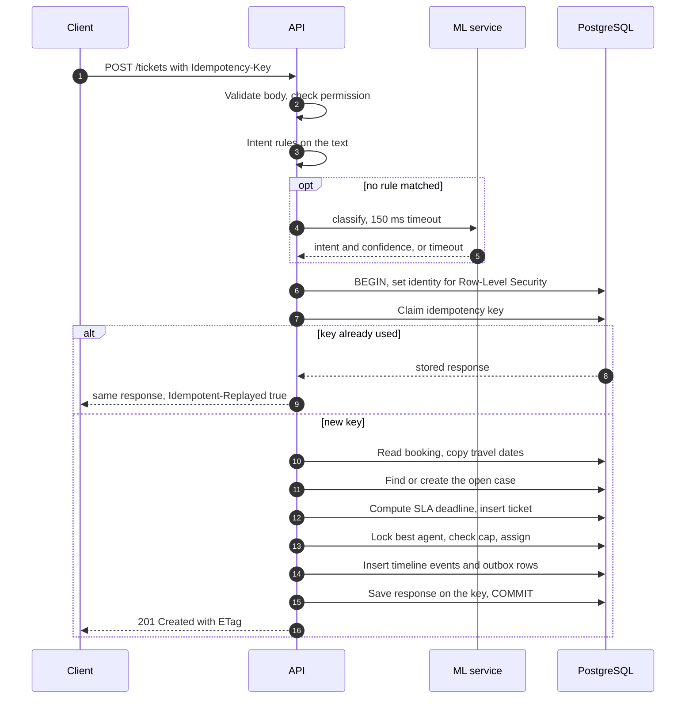
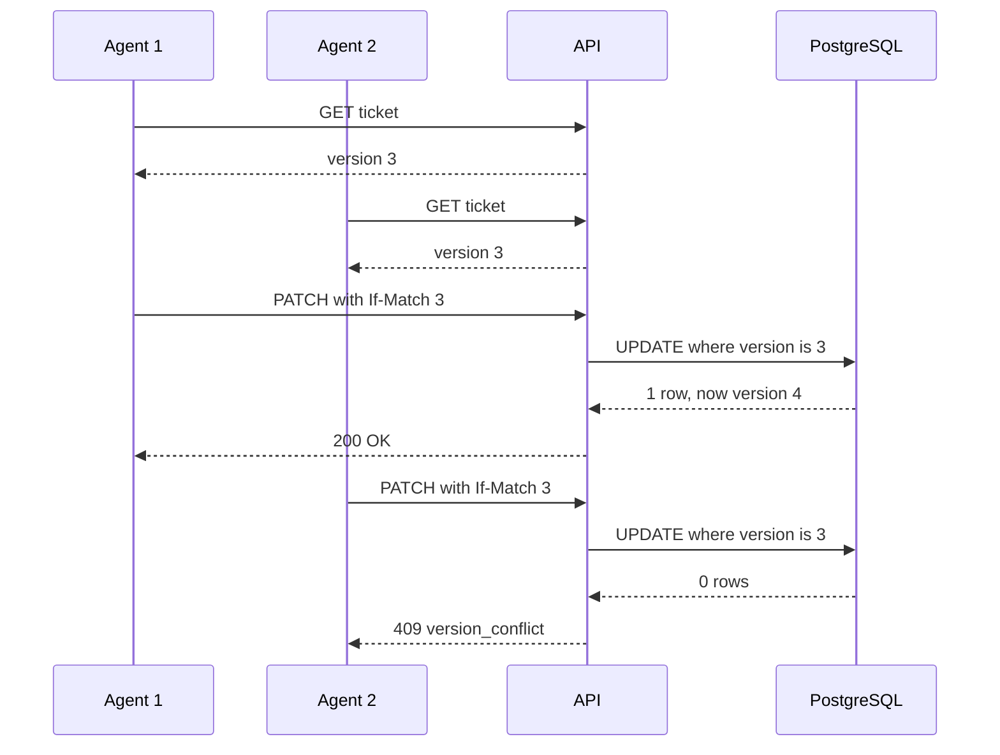
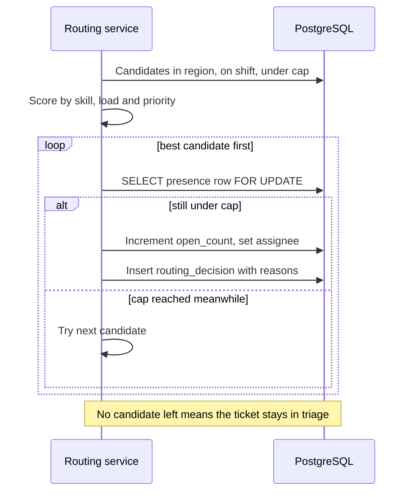
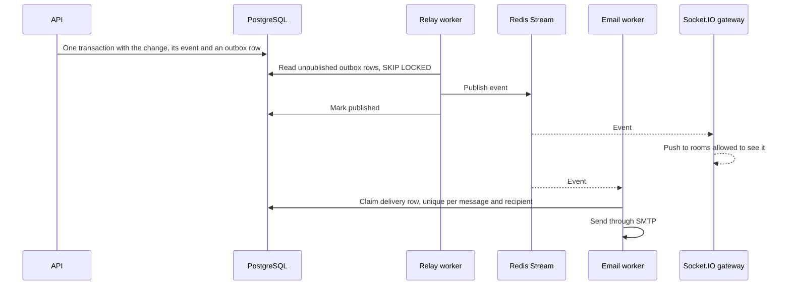
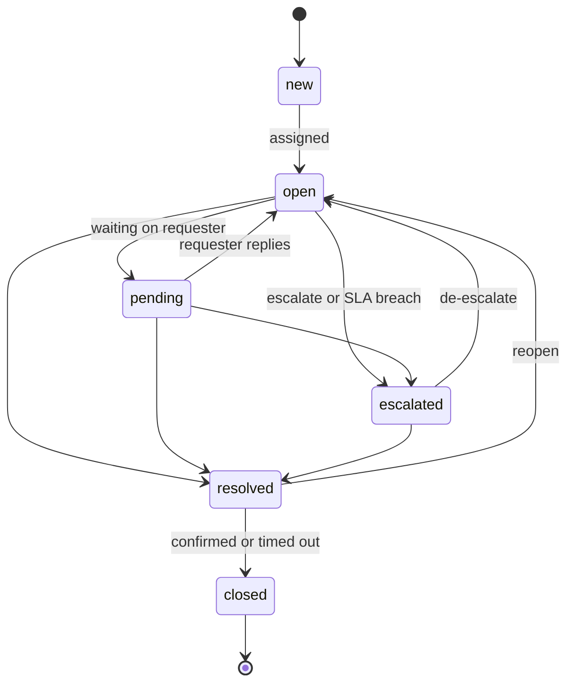

# OpsDesk

A travel-aware operations ticketing system. Travel agencies raise tickets about hotel bookings, and support staff resolve them. Every ticket knows which booking it belongs to, so related contacts are grouped into one case, work is routed to the right agent, and deadlines follow the traveller's check-in date instead of a generic clock.

**Stack:** PostgreSQL, Express, React, Node (PERN), with Redis for queues and a small Python service for machine learning.

**Status:** all six phases are built and their gate tests pass: the ticket core; intent classification and linkage; SLA, routing, workers and queues; side conversations, outbox relay, email, webhook and WebSockets; weekly themes, streaming export, archival, rate limiting, metrics and contract tests; and the React app with real sign-up, email verification, password reset and staff invitations, k6 load tests and CI. Measured: reads p95 10.9 ms at 50 requests per second and ticket create p95 68.9 ms, over 200,000 tickets ([docs/load-test.md](docs/load-test.md)); a 100,000-row export streams in 4.8 s with live heap growth of 3.1 MB; Schemathesis found no 500s in 7,821 generated requests. The intent model is trained on synthetic tickets, so its macro-F1 (0.997) shows the pipeline works, not real-world quality. To see it, follow [docs/demo.md](docs/demo.md).

## Contents

1. [What OpsDesk is](#1-what-opsdesk-is)
2. [Goals and non-goals](#2-goals-and-non-goals)
3. [Requirements](#3-requirements)
4. [Capacity estimate](#4-capacity-estimate)
5. [Architecture](#5-architecture)
6. [Tech stack](#6-tech-stack)
7. [Data model](#7-data-model)
8. [Data integrity rules](#8-data-integrity-rules)
9. [Concurrency hazards](#9-concurrency-hazards)
10. [Key flows](#10-key-flows)
11. [Ticket state machine](#11-ticket-state-machine)
12. [Tenant isolation and security](#12-tenant-isolation-and-security)
13. [API design](#13-api-design)
14. [ML service boundary](#14-ml-service-boundary)
15. [Background work](#15-background-work)
16. [Observability](#16-observability)
17. [Testing strategy](#17-testing-strategy)
18. [Roadmap](#18-roadmap)
19. [Repository layout](#19-repository-layout)
20. [Trade-offs and scaling](#20-trade-offs-and-scaling)

---

## 1. What OpsDesk is

### The problem

A B2B travel platform sells hotel rooms to travel agencies. When something goes wrong (a booking is missing at the hotel, a refund has not arrived, a voucher shows the wrong dates) the agency contacts support. A generic helpdesk handles this badly in four ways:

- **Contacts are scattered.** The same agency emails three times about one booking and three different agents pick the tickets up, each without the others' context.
- **Urgency is wrong.** A ticket about a guest arriving tonight waits behind one about a stay three months away, because both are "normal priority".
- **Routing is manual.** A lead reads each ticket and assigns it by hand, with no record of why.
- **Supplier conversations break.** An agent emails the hotel, the ticket is moved to another team, and the hotel's reply goes nowhere.

### What "travel-aware" means

Each ticket is tied to a booking, identified by its booking reference (**TBOH**). Two dates on that booking drive everything:

| Term | Meaning | Why it matters |
|---|---|---|
| **Check-in** | The day the guest arrives at the hotel | After this, most problems can no longer be fixed |
| **LCD** (Last Cancellation Date) | The last moment the booking can be cancelled without a fee | After this, a mistake costs real money |

OpsDesk uses these to compute deadlines: a ticket must be answered before the booking's own deadline, not just within a fixed number of hours.

### Who uses it

| Role | Who | Can do |
|---|---|---|
| **Requester** | A user at a travel agency | Raise tickets, reply, see only their own agency's tickets and public replies |
| **Agent** | Support staff | Work tickets, write internal notes, talk to suppliers |
| **Escalation manager** | Senior support | Own escalated tickets, de-escalate |
| **Lead** | Team lead | Everything an agent can, plus reassignment, exports and insights |

---

## 2. Goals and non-goals

### Goals

- Treat a ticket as part of a **case**: every related contact on the same booking is visible together.
- **Route** tickets by region, shift, priority and agent load, and record the reason for each decision.
- Compute **SLA deadlines** from real travel urgency, and make escalation an explicit state change.
- Keep **side conversations** with suppliers correct when tickets move between teams.
- Serve **large exports** and near-real-time updates with no row caps.
- Enforce strict **tenant isolation**: an agency never sees another agency's data.
- Keep data **correct under concurrency**: no duplicate tickets, no lost edits, no agent over their limit.

### Non-goals

- Phone, WhatsApp or social intake. Email and a web form are enough.
- Production single sign-on, billing, or serving many separate companies.
- A large language model layer. Machine learning is limited to intent and theme classification.

### Assumptions

- One organisation runs OpsDesk; its customers are many agencies.
- Agent shifts and regional holiday calendars are seeded, not pulled from an HR system.
- OpsDesk issues its own login tokens. A real identity provider would replace this.
- Email is sent to a local mail catcher (Mailpit), so no real message leaves the machine.

---

## 3. Requirements

### Functional

| # | Requirement | Phase |
|---|---|---|
| F1 | Tickets carry agency, TBOH, intent, priority, check-in, LCD and region | 1 |
| F2 | New tickets link automatically to open or recent tickets on the same TBOH, or the same agency and intent | 2 |
| F3 | Intent is suggested on create; agents can override it, and overrides are logged | 2 |
| F4 | Status machine New, Open, Pending, Escalated, Resolved, Closed with guarded transitions | 1 |
| F5 | Every change appends to the ticket's timeline | 1 |
| F6 | Routing by region, shift window, priority and agent load, with a stored reason | 3 |
| F7 | Queue views: triage, my queue, by region, by intent, linked cases, escalations | 3 |
| F8 | Side conversations with explicit recipients that survive a transfer | 4 |
| F9 | Internal notes are never sent or shown to agencies | 1 |
| F10 | SLA deadline from priority, check-in and LCD proximity, and regional holidays | 3 |
| F11 | At-risk and breached flags on queues; automatic escalation on breach | 3 |
| F12 | Escalating to an escalation manager changes owner and queue | 3 |
| F13 | Weekly themes with counts and sample tickets | 5 |
| F14 | Streaming CSV export with no row cap, plus a cursor-paginated API | 5 |
| F15 | Archival of closed tickets after a retention window | 5 |
| F16 | Roles: requester, agent, escalation manager, lead | 1 |

### Non-functional targets

| Property | Target | Measured |
|---|---|---|
| Read latency | p95 under 150 ms at 50 requests per second on a laptop | 10.9 ms over 200,000 tickets (k6) |
| Ticket create (classify, link, route included) | p95 under 300 ms | 68.9 ms at 5 per second, ML included (k6) |
| Export | 100,000 rows streamed in under 30 s with flat memory | 4.8 s, live heap +3.1 MB |
| Realtime | A state change reaches connected clients within 2 s | under 2 s (test); about 220 ms in a browser |
| Correctness | No duplicate ticket from a retry; no lost update; no agent above their cap; no cross-agency read |
| Durability | A committed change is never lost, and its event is never silently dropped |
| Availability of create | Ticket create keeps working when the ML service, Redis or email is down |

---

## 4. Capacity estimate

Estimating first tells us which problems are real. The design load is **50,000 tickets per day**.

| Quantity | Working | Result |
|---|---|---|
| Average ticket writes | 50,000 / 86,400 s | about 0.6 per second |
| Peak ticket writes | 10 times average | about 6 per second |
| Timeline events | about 8 per ticket | 400,000 per day, about 146 million per year |
| Messages | about 4 per ticket | 200,000 per day, about 73 million per year |
| Tickets | 50,000 per day | about 18 million per year |
| Storage | tickets about 2 KB, messages about 1.5 KB, events about 0.4 KB, indexes included | roughly 200 GB per year before archival |
| Reads | 500 staff with open queues | tens of requests per second |

What this tells us:

- **Throughput is not the hard part.** A single PostgreSQL server handles thousands of simple writes per second. Six per second needs no sharding, no message broker cluster and no microservices.
- **Correctness is the hard part.** With hundreds of people and several background jobs touching the same tickets, the risk is two valid requests arriving at the wrong moment. Most of this design is about that.
- **Growth is in two tables.** Events and messages grow by over 200 million rows a year, so those two are partitioned by month and archived. Tickets stay small enough to index normally.
- **Reads dominate.** Queue views are read far more often than tickets are written, so indexes are designed around the queue queries, and paging never uses `OFFSET`.

---

## 5. Architecture

### Components



### Why a modular monolith

One Node codebase owns all writes, and PostgreSQL is the only source of truth. The API, the WebSocket gateway and the workers are separate processes started from the same code.

- **One transaction can cover everything that must change together**: the ticket, its timeline entry and the event that announces it. Split across services, that needs distributed coordination, for no gain at six writes per second.
- **The database does work that would otherwise be code**: foreign keys, check constraints, row locks and Row-Level Security.
- **Module boundaries are kept clean** (`domain`, `services`, `routes`, `workers`), so a part could be cut out into its own service later if it ever needed to scale alone.

The cost is one failure domain: a slow endpoint shares resources with fast ones. Slow work is therefore pushed to workers.

### What each part owns

| Part | Owns | Never does |
|---|---|---|
| Express API | Validation, permissions, all state changes, reads | Slow work inside a request (email, exports to file, clustering) |
| PostgreSQL | Every durable fact | Hold anything that only lives in memory elsewhere |
| Redis | Job queues, the event stream, rate-limit counters | Hold anything that cannot be rebuilt from PostgreSQL |
| Workers | Scheduled and queued work, each job safe to run twice | Bypass the service layer to change tickets |
| ML service | Answers about text | Touch the database or see credentials |
| Socket.IO gateway | Pushing events to browsers | Decide who may read; it applies the same rules as the API |

### Layers inside the API

```
routes/      parse the request, call one service function, shape the response
services/    the only place state changes: opens a transaction, applies rules, records events
domain/      pure functions: state machine, permissions, SLA maths, routing score (no I/O)
db/          table definitions and the transaction helper
```

A rule lives in exactly one layer. Pure rules in `domain/` are tested with no database at all, which keeps the test suite fast and the rules easy to reason about.

### What happens when a part fails

| Failure | Effect | Why it is safe |
|---|---|---|
| ML service down or slow | Ticket is created with intent `other` and flagged for review | The call has a short timeout and a circuit breaker; create never waits on it |
| Redis down | API keeps accepting writes; realtime updates and emails are delayed | Events wait in the `outbox` table and are published when Redis returns |
| Worker crashes mid-job | The job runs again | Every job is idempotent |
| Email server down | Sends are retried with backoff, then parked in a dead-letter table | The message itself is already saved |
| API process crashes mid-request | The transaction rolls back; the client retries with the same idempotency key | Nothing is half-written |
| PostgreSQL down | The system is down | It is the single source of truth by design; `/readyz` reports it |

---

## 6. Tech stack

| Concern | Choice | Why |
|---|---|---|
| Language | TypeScript on Node 22 or newer | One language for API, workers and UI; types catch mistakes in request and row shapes |
| HTTP | Express 5 | Small and well understood; middleware fits auth, idempotency and rate limiting |
| Validation | Zod | One schema validates the request and generates the OpenAPI document |
| Database | PostgreSQL 16 | Transactions, constraints, row locks, Row-Level Security, partitioning, full-text search |
| Queries | `pg` with Drizzle ORM | Typed queries that stay close to SQL, with raw SQL where needed |
| Migrations | Plain SQL files, node-pg-migrate | Partitions, policies and grants need real SQL; a file per change is easy to review |
| Queues | Redis 7 with BullMQ | Retries, backoff, scheduled jobs |
| Events | Redis Streams | Ordered, replayable, consumer groups |
| Realtime | Socket.IO | Rooms map directly to "who may see this" |
| ML | Python, FastAPI, scikit-learn | The standard tools for TF-IDF, logistic regression and k-means |
| Email | Nodemailer to Mailpit | Real SMTP behaviour with nothing leaving the machine |
| Files | MinIO | S3-compatible storage for exports and archives |
| Frontend | React, Vite, TanStack Query | Server state with caching and refetching handled for us |
| Accounts | Own, in PostgreSQL: argon2id, JWT plus rotating refresh tokens, hashed email-link tokens | Users are referenced by foreign keys and RLS; a hosted identity provider would live outside the database ([ADR 0003](docs/adr/0003-own-auth-in-postgres.md)) |
| Tests | Vitest, Supertest, Testcontainers, fast-check | Real PostgreSQL in tests; property tests for date maths |
| Observability | pino, prom-client, OpenTelemetry, Grafana | Logs, metrics and traces tied together by a request id |
| Load and contract | k6, Schemathesis | Measured latency; the API is checked against its own specification |
| Local infrastructure | Docker Compose | One command starts every dependency |

---

## 7. Data model

### Relationships



### Core tables (Phase 1)

| Table | Purpose | Keys and constraints worth knowing |
|---|---|---|
| `regions` | MEA, EU, APAC, AMER, each with a time zone | Primary key is the code; time zone is required because business hours depend on it |
| `agencies` | Customers | Unique `slug`; `is_active` instead of deletion |
| `teams` | Support teams, one region each | Foreign key to `regions` |
| `users` | Everyone who logs in | Unique lower-cased email; `role` restricted by `CHECK`; a requester **must** have an `agency_id` and staff **must not** (one `CHECK` across both columns); `is_active` instead of deletion |
| `suppliers` | Hotels and wholesalers | Unique `code` |
| `bookings` | One hotel booking | Unique `tboh`; foreign keys to agency and supplier; `check_in_date`, `hotel_time_zone`, `lcd_at`; `CHECK (lcd_at <= check-in)`; `amount numeric(12,2)` with `currency char(3)` |
| `cases` | A group of tickets about one booking | At most **one open case per booking**, enforced by a partial unique index |
| `tickets` | The unit of work | See below |
| `ticket_events` | Append-only timeline | Partitioned by month; no `UPDATE` or `DELETE` allowed for the application |
| `messages` | Public replies and internal notes | Partitioned by month; `visibility` is `public` or `internal`; append-only |
| `outbox` | Events waiting to be published | Written in the same transaction as the change; partial index on unpublished rows |
| `idempotency_keys` | One row per client retry key | Unique `(user_id, key)`; stores request hash, status and response body |
| `refresh_tokens` | Login sessions | Stores only a SHA-256 hash; `used_at` makes each token single-use |

### The `tickets` table

| Column group | Columns | Rule |
|---|---|---|
| Identity | `id` (UUID), `agency_id`, `booking_id`, `case_id`, `requester_id` | All foreign keys; `agency_id` must equal the booking's agency (composite foreign key) |
| Content | `subject`, `body` | Required, length-limited; a generated `search_vector` column feeds full-text search |
| Classification | `intent`, `intent_source`, `needs_review`, `priority` | Values restricted by `CHECK` |
| Workflow | `status`, `assignee_id`, `team_id` | `status` restricted by `CHECK`; a `new` ticket has no assignee |
| Travel copy | `check_in_at`, `lcd_at`, `region` | Copied from the booking at create so queues sort without a join |
| SLA | `sla_due_at`, `sla_state`, `sla_paused_at`, `sla_paused_total` | `sla_paused_at` is set only while status is `pending` |
| Lifecycle | `created_at`, `updated_at`, `resolved_at`, `closed_at` | `resolved_at` is set if and only if status is `resolved` or `closed` |
| Concurrency | `version` | Starts at 1, incremented by every update |

### Tables added later

| Phase | Tables |
|---|---|
| 2 | `intent_overrides`, `ticket_links` |
| 3 | `agent_shifts`, `agent_presence`, `agent_skills`, `routing_decisions`, `sla_policies`, `region_holidays`, `ticket_watchers`, `dead_letter_jobs` |
| 4 | `side_conversations`, `side_participants`, `side_messages`, `email_deliveries`, `inbound_emails`, `inbound_quarantine` |
| 5 | `theme_weekly`, `export_jobs`, `archive_manifests` |

A table is created in the phase that first uses it. Nothing is added "for later".

### Indexes follow the queries

| Query | Index |
|---|---|
| A queue ordered by deadline | `(team_id, sla_due_at)` restricted to live statuses (partial index) |
| My queue | `(assignee_id, sla_due_at)` restricted to live statuses |
| An agency's tickets, newest first, paged | `(agency_id, created_at DESC, id DESC)` |
| All tickets on a booking | `(booking_id)` |
| A ticket's timeline | `(ticket_id, created_at)` on each partition |
| Text search | GIN on `search_vector` |
| Unpublished events | Partial index on `outbox (id) WHERE published_at IS NULL` |

Partial indexes keep the hot indexes small: closed tickets are most of the table but are never in a queue.

### Design choices explained

- **UUID primary keys.** Ids appear in URLs. Sequential numbers would let anyone guess how many tickets exist and probe neighbours.
- **Normalised first, denormalised on purpose.** Bookings are the single home of travel dates. The ticket carries a copy only because queue sorting needs it, and bookings are not edited after import, so the copy cannot drift.
- **`agency_id` repeated on messages and events.** Row-Level Security policies can then check one column instead of joining. A composite foreign key `(ticket_id, agency_id)` to `tickets (id, agency_id)` makes it impossible for the copy to disagree with the ticket.
- **Partitioning by month** on the two tables that grow fastest. Queries for one ticket touch few partitions, and old months can be detached and archived as a unit instead of deleting rows one by one. The primary key is `(id, created_at)` because PostgreSQL requires the partition key in it. A default partition catches anything outside the created range.
- **Events are separate from messages.** Events are facts about what changed, used for audit and realtime. Messages are what people wrote. They have different readers and different visibility rules.

---

## 8. Data integrity rules

These are design rules, not aspirations. Each is enforced by the database where the database can do it, and each has a test. The aim is that an integrity audit of the finished system finds nothing.

### 8.1 Schema and relationships

- **Every reference is a real foreign key.** No "soft" ids pointing at rows that might not exist.
- **Every foreign key states its `ON DELETE` rule.** The default is `RESTRICT`: a row that others depend on cannot be removed. `CASCADE` is used only where the child has no meaning alone (session tokens of a user).
- **`NOT NULL` unless absence means something.** `assignee_id` may be null (unassigned). `subject` may not.
- **`CHECK` constraints for closed sets and cross-column rules**: status, priority, role, visibility; requester has an agency and staff do not; `lcd_at` is not after check-in; counters are not negative.
- **The server validates too**, with Zod, so users get clear errors. The database is the last line: it holds even if a script, a migration or a future service writes directly.

### 8.2 Duplicates, orphans and deletion

- **Unique constraints on natural keys**: user email (case-insensitive), booking `tboh`, supplier `code`, `(user_id, idempotency_key)`, one presence row per agent, one participant row per person per side conversation.
- **Uniqueness that depends on state uses partial unique indexes**: one open case per booking.
- **No hard deletes of business data.** The application's database role has no `DELETE` privilege on any business table. Users and agencies are deactivated with `is_active`. Tickets end in `closed`. Removal happens only through archival, which is a separate, audited job.
- **Orphans are impossible, not cleaned up**: foreign keys with `RESTRICT` and no deletes mean there is nothing to orphan.
- **Denormalised copies cannot disagree**, because composite foreign keys tie them to their source.

### 8.3 Transactions and concurrency

- **Every multi-step write is one transaction.** Creating a ticket writes the idempotency key, the ticket, the case link, the timeline event and the outbox row together, or none of them.
- **Lost updates are prevented by a `version` column** checked in the `WHERE` clause of every update.
- **Duplicate creates are prevented by idempotency keys** claimed inside the creating transaction.
- **Counters change only under a row lock**, in the same transaction as the fact they count, and are bounded by a `CHECK`. A nightly job recounts and reports any drift.
- **Queue pulls use `FOR UPDATE SKIP LOCKED`** so two workers never take the same row.
- **No external call happens inside a transaction.** Email, the ML service and Redis are called before or after, never while row locks are held.
- **Transactions are short.** A human never holds a lock: editing uses optimistic versioning.

Section 9 lists each race in detail.

### 8.4 Business rules

- **Status changes go through one transition table** on the server, used by every code path including background jobs.
- **The database backs the rules it can express**: allowed status values, `resolved_at` only in resolved or closed states, no assignee on a `new` ticket.
- **Nothing is enforced only in the browser.** The UI hides buttons for convenience; the server decides.
- **A failed write rolls back completely** and returns a typed error with a stable code. Database errors are mapped: unique violation to `409`, foreign key violation to `422`, serialization failure to a bounded retry.

### 8.5 Data types and time

- **All instants are `timestamptz`, stored in UTC.** `timestamp without time zone` is not used anywhere.
- **The server clock is the only clock.** `created_at` defaults to `now()` in the database. Client-supplied times are never trusted for ordering.
- **Calendar dates and instants are different types.** A check-in is a date at a hotel; it becomes an instant only with the hotel's time zone and a stated time of day. `lcd_at` is stored as an instant because it is a precise cut-off.
- **Business-hours maths converts explicitly** to the region's time zone, so shifts and holidays behave correctly across daylight-saving changes.
- **Ranges are half-open**: `created_at >= start AND created_at < end`. This removes the classic end-of-day and end-of-month boundary bugs, and matches how partitions are defined.
- **Money is `numeric(12,2)` with a currency code.** Floating point is never used for amounts.
- **Durations are stored as integers of seconds**, not as floats.

### 8.6 Migrations and maintainability

- **The schema changes only through numbered SQL migration files** in the repository. Nobody edits the database by hand.
- **Migrations are forward-only and never edited after they are merged.** A mistake is fixed by a new migration.
- **Two database roles.** Migrations run as the owner. The application runs as a role that owns nothing, cannot bypass Row-Level Security, and has only the privileges it needs.
- **Risky changes are done in safe steps**: add a column as nullable, backfill in batches, then add `NOT NULL`; create indexes with `CONCURRENTLY`; add constraints as `NOT VALID`, then validate.
- **Drift is detected**: CI builds a database from the migrations and compares it with the table definitions used by the code.
- **No dead structure**: a column or table with no reader is removed by a migration.

---

## 9. Concurrency hazards

A database does not only break because of bad code. It also breaks when two perfectly valid requests arrive at exactly the wrong time. Each row below is one such case, the mechanism that prevents it, and the test that will prove it.

| # | Two things happen at once | What would go wrong | Prevention | Proof |
|---|---|---|---|---|
| 1 | A client times out and retries `POST /tickets` | Two tickets for one problem | `Idempotency-Key` row inserted with `ON CONFLICT DO NOTHING` inside the create transaction; the retry waits on the first, then replays its saved response | 10 simultaneous identical creates produce 1 ticket |
| 2 | Two agents save edits to the same ticket | The second save silently erases the first | `UPDATE … WHERE id = $1 AND version = $2`; zero rows means `409 version_conflict` | 12 simultaneous edits, exactly 1 succeeds |
| 3 | Two agents click "assign to me" | Both believe they own the ticket | Same version check; the loser gets `409` and refreshes | Simultaneous assigns, 1 winner |
| 4 | Many tickets are routed to one agent at once | The agent ends up above their cap | `SELECT … FOR UPDATE` on the agent's presence row, cap re-checked after the lock, and `CHECK (open_count <= max_open)` as a backstop | 100 simultaneous creates, no agent above cap |
| 5 | Two workers pull from the triage queue | The same ticket is assigned twice | `FOR UPDATE SKIP LOCKED`: each worker locks a different row | Parallel pulls return distinct tickets |
| 6 | Two tickets arrive for a booking that has no case yet | Two open cases for one booking | Partial unique index (one open case per booking) with `INSERT … ON CONFLICT`, then re-read | Simultaneous creates on one TBOH share one case |
| 7 | The SLA scanner escalates while an agent resolves | A resolved ticket is escalated, or the resolve is lost | The scanner uses the same transition path and version check as a person; whoever commits second is rejected, and the scanner simply skips | Scanner and resolve raced in a test, final state is valid |
| 8 | Two scanner instances run together | A ticket is escalated twice, with duplicate events | Rows are selected with `SKIP LOCKED` and the transition is conditional on the current status | Two scanners, one escalation event |
| 9 | A refresh token is used twice at the same moment | Two valid sessions from one token | `UPDATE … SET used_at = now() WHERE token_hash = $1 AND used_at IS NULL RETURNING`; the second use matches nothing and revokes the whole session family | Parallel refresh, 1 success, family revoked |
| 10 | Two relay workers read the outbox | An event is published twice | `SKIP LOCKED` on unpublished rows; delivery is still at-least-once, so consumers ignore event ids they have seen | Duplicate event delivered, effect applied once |
| 11 | The email worker crashes after sending and before recording it | The supplier receives the same email twice | `email_deliveries` has a unique `(message_id, recipient)`; the row is claimed before sending and the SMTP `Message-ID` is fixed | Job killed and retried, 1 email in Mailpit |
| 12 | The mail provider delivers an inbound webhook twice | A reply appears twice in the thread | Unique provider message id on `inbound_emails` | Same webhook posted twice, 1 message |
| 13 | A requester replies while an agent closes the ticket | The reply lands on a closed ticket and nobody sees it | Adding a message locks the ticket row briefly and applies the reopen rule in the same transaction | Reply and close raced, ticket ends open with the reply visible |
| 14 | A pooled connection is reused by the next request | The next user runs with the previous user's identity | Identity is set with `set_config(…, true)`, which is transaction-local and vanishes at commit | Reused connection with no context returns no rows |
| 15 | An event is written just after midnight on the first of a month | The insert fails because the month's partition does not exist | A job creates partitions three months ahead, and a default partition catches the rest | Insert with a far-future date succeeds |
| 16 | A ticket is transferred while its counters are updated | The old agent's load is not decremented, or is decremented twice | Both presence rows are locked in a fixed order (by id) to avoid deadlock, and both counters change in the transfer's transaction | Concurrent transfers, counters equal a recount |
| 17 | Code reads a status, decides, then writes | The status changed in between (check-then-act) | Decisions are made on a row read in the same transaction, and the write repeats the condition in its `WHERE` | Covered by 2, 7 and 13 |

### The ideas behind the table

- **Optimistic locking** (cases 2, 3, 7): assume conflicts are rare, detect them at write time with a version number, and make the loser retry. Right for anything a human edits, because no lock is held while a person thinks.
- **Pessimistic locking** (cases 4, 13, 16): take a row lock first, for a few milliseconds, around a hot counter or a decision that must not interleave. Right for short, contended, machine-speed sections.
- **`SKIP LOCKED`** (cases 5, 8, 10): turn a table into a work queue. Workers do not wait for each other; each takes the next free row.
- **Unique constraints as arbiters** (cases 1, 6, 9, 11, 12): when two requests race to create the same thing, let the database pick the winner. "Check first, then insert" always has a gap.
- **Idempotency** (cases 1, 10, 11, 12): anything that can be retried must be safe to run twice.
- **Lock ordering** (case 16): when two rows must be locked, always lock them in the same order, or two transactions can each hold one and wait forever for the other.
- **Isolation level**: PostgreSQL's default, Read Committed, is used throughout. The guarantees above come from explicit locks, version checks and constraints, which are visible in the code, instead of relying on Serializable and retry loops everywhere.

---

## 10. Key flows

### 10.1 Create a ticket



The ML call is made **before** the transaction opens, so no database lock is held while waiting on the network.

### 10.2 Edit with a version check



### 10.3 Routing an assignment



The first query is only a shortlist. The cap is checked again after the lock, because another transaction may have assigned to the same agent in between.

### 10.4 From a change to an email and a live update



This is the **transactional outbox** pattern. "Commit, then publish" loses the event if the process dies between the two lines. "Publish, then commit" announces a change that may roll back. Writing the event in the same transaction as the change removes both failures. Delivery becomes at-least-once, which is why every consumer is idempotent.

### 10.5 SLA scan and automatic escalation

1. Every 60 seconds a worker selects live tickets whose `sla_due_at` is near or past, using `SKIP LOCKED`.
2. Near the deadline, `sla_state` becomes `at_risk`; past it, `breached`.
3. A breached ticket is escalated through the same service function a person would use, as the `system` actor, so the timeline shows who did it and the same rules apply.
4. If the ticket changed in the meantime (resolved, already escalated), the transition is rejected and the scanner moves on.

---

## 11. Ticket state machine



The rules are one table of `(from, to) → roles allowed`. Anything not in the table is illegal.

| From | To | Who |
|---|---|---|
| new | open | staff, system |
| open | pending | staff |
| open | escalated | staff, system |
| open | resolved | staff |
| pending | open | anyone on the ticket (a requester's reply does this) |
| pending | escalated | staff, system |
| pending | resolved | staff |
| escalated | open | escalation manager, lead |
| escalated | resolved | escalation manager, lead |
| resolved | open | anyone on the ticket (reopen) |
| resolved | closed | anyone on the ticket, system (after a quiet period) |

"Staff" means agent, escalation manager and lead. `closed` is final: a new problem is a new ticket, linked into the same case.

Why a table and not `if` statements: the whole policy fits on one screen, a test can check every one of the 6 × 6 × roles combinations, and adding a state is one row instead of a hunt through the code.

Side effects belong to the transition, not to the caller: entering `pending` pauses the SLA clock, leaving it resumes the clock, entering `resolved` sets `resolved_at` and releases the agent's load, entering `escalated` changes owner and queue.

---

## 12. Tenant isolation and security

### Isolation is enforced twice

1. **In the application**: a permission table decides whether a role may perform an action at all.
2. **In the database**: Row-Level Security (RLS) policies decide which rows a session can see or write.

Filtering only in application code works until one query forgets `WHERE agency_id = …`, and that one query is a data leak. With RLS, the forgotten filter returns nothing.

### How RLS is wired

- **A separate database role.** Table owners and superusers bypass RLS. The API connects as `opsdesk_app`, which owns nothing and is `NOBYPASSRLS`. Migrations run as the owner.
- **Identity is set per transaction.** Every request runs inside one helper that begins a transaction and calls `set_config('app.role', …, true)`, `set_config('app.agency_id', …, true)` and `set_config('app.user_id', …, true)`. The `true` makes the setting local to the transaction, so a pooled connection cannot carry one user's identity to the next request.
- **Policies fail closed.** If the settings are missing, the policy expression is null and no rows match. Forgetting to set identity shows nothing, not everything.
- **Hidden means not found.** A ticket hidden by RLS returns `404`, the same as one that does not exist, so ids cannot be probed.
- **Internal notes** are rows with `visibility = 'internal'`. The policy hides them from requesters in the database, so no endpoint can leak them by accident.
- **The helper is the only way to reach the database.** There is no way to run a query without identity.

### Authentication

| Item | Design |
|---|---|
| Passwords | Argon2id hashes; never logged, never returned |
| Access token | JWT, 15 minutes, carries user id, role, agency and team |
| Refresh token | Random, single use, rotated on every refresh; only its SHA-256 hash is stored |
| Reuse detection | Using an already-used refresh token revokes every session in that family, because it means the token was stolen |
| Login errors | The same message and timing whether the email exists or not |

### Other controls

| Risk | Control |
|---|---|
| SQL injection | Parameterised queries only; no string-built SQL |
| Mass assignment | Zod schemas reject unknown fields; the server sets `agency_id`, `requester_id` and `status`, never the client |
| Account takeover by email link | Links carry 32 random bytes; only the SHA-256 is stored; single use; one live link per person and purpose; reset expires in 1 hour and ends every session |
| Account enumeration | Sign-up, "forgot password" and "resend" answer the same 202 for known and unknown addresses, and send the email without waiting, so the timing is the same; the email says what happened |
| Forged inbound email | HMAC signature with a shared secret, compared in constant time, with a timestamp to stop replays |
| Abuse and scraping | Token-bucket rate limits in Redis per user and per agency; `429` with `Retry-After` |
| Leaked secrets | Secrets only in environment variables; `.env` is git-ignored; a pre-commit hook scans for secrets; the app refuses to start with a missing or short secret |
| Service-to-service | The ML service accepts only a shared-secret header and is not exposed outside the internal network |
| Realtime leaks | Socket.IO rooms are joined from the verified token, and events are filtered by the same visibility rules as the API |
| Audit | The timeline is append-only: the application role has no `UPDATE` or `DELETE` on it |

---

## 13. API design

REST over JSON under `/api/v1`. The OpenAPI document is generated from the Zod schemas and served at `/docs`.

### Resources

| Method and path | Purpose | Phase |
|---|---|---|
| `POST /auth/login`, `POST /auth/refresh`, `POST /auth/logout` | Sessions | 1 |
| `POST /auth/signup`, `POST /auth/verify-email`, `POST /auth/verify-email/resend` | Agency sign-up and email verification | 6 |
| `POST /auth/password/forgot`, `POST /auth/password/reset` | Forgotten password (ends every session) | 6 |
| `POST /staff/invites`, `POST /auth/invites/accept` | Leads invite staff; staff never sign up themselves | 6 |
| `POST /tickets` | Create (requires `Idempotency-Key`) | 1 |
| `GET /tickets` | List with filters, search and cursor paging | 1 |
| `GET /tickets/{id}` | Detail, with `ETag` | 1 |
| `PATCH /tickets/{id}` | Edit fields (requires `If-Match`) | 1 |
| `POST /tickets/{id}/transitions` | Change status | 1 |
| `POST /tickets/{id}/assign` | Assign or transfer | 1 |
| `GET` and `POST /tickets/{id}/messages` | Replies and internal notes | 1 |
| `GET /tickets/{id}/timeline` | Events | 1 |
| `PUT /tickets/{id}/intent` | Override intent | 2 |
| `POST` and `DELETE /tickets/{id}/links` | Manual link and unlink | 2 |
| `GET /cases/{id}` | Case view | 2 |
| `POST /tickets/{id}/escalate`, `POST /tickets/{id}/de-escalate` | Escalation | 3 |
| `GET /queues/{name}` | Triage, mine, by region, by intent, escalations | 3 |
| `PUT /me/presence` | Go online or offline | 3 |
| `GET` and `POST /tickets/{id}/side-conversations` | Supplier threads | 4 |
| `POST /inbound/email` | Signed webhook for replies | 4 |
| `GET /insights/themes` | Weekly themes | 5 |
| `GET /exports/tickets.csv`, `POST /exports` | Streaming and background export | 5 |
| `GET /staff` | Staff directory with team and load, for the UI | 6 |
| `GET /healthz`, `GET /readyz`, `GET /metrics` | Operations | 1, 5 |

### Conventions

- **Actions that are not plain edits are their own endpoints.** A status change has rules and side effects, so it is `POST …/transitions`, not a `PATCH` of the status field.
- **Errors use RFC 9457 `application/problem+json`** with a stable machine-readable `code`:

  ```json
  {
    "type": "https://opsdesk.dev/problems/version-conflict",
    "title": "Version conflict",
    "status": 409,
    "code": "version_conflict",
    "detail": "The ticket was changed by someone else. Reload and try again.",
    "request_id": "req_8f2c1a"
  }
  ```

- **Status codes mean one thing each**: `400` malformed, `401` not logged in, `403` role may not do this, `404` not found or not visible, `409` conflict with current state, `422` valid JSON that breaks a rule, `429` rate limited.
- **Keyset pagination.** Lists are ordered by `(created_at, id)` and return an opaque `next_cursor`. `OFFSET` is not used: it gets slower with depth and skips or repeats rows when data changes between pages.
- **Idempotency.** `POST /tickets` requires an `Idempotency-Key` header. The same key with the same body replays the first response; the same key with a different body is a `422`, because that is a client bug, not a retry. Keys expire after 24 hours.
- **Concurrency.** `GET` returns the version as an `ETag`. `PATCH` requires `If-Match`. Missing header is `428`; stale version is `409`.
- **Versioning.** Breaking changes go to `/api/v2`. Adding optional fields is not a breaking change.
- **Request ids.** Every response carries `X-Request-Id`, which also appears in logs and traces.

---

## 14. ML service boundary

The Node API owns all data and all writes. The Python service only answers questions about text. That keeps the split easy to explain and easy to replace.

| Endpoint | Used by | Returns |
|---|---|---|
| `POST /classify` | Ticket create | Intent, confidence, top three suggestions, model version |
| `POST /similarity` | Linkage | Cosine similarity between a new ticket and candidate tickets |
| `POST /themes/cluster` | Weekly worker job | Clusters with top terms and sample ticket ids |
| `GET /healthz` | API readiness | Whether a model is loaded, and its version |

### Rules for the boundary

- **Cheap rules run first, in Node.** Keywords and patterns catch the obvious intents with no network call. The model is asked only when no rule fires.
- **The model can never block a ticket.** The call has a 150 ms timeout and a circuit breaker. On timeout, error or an open breaker, the ticket is created with `intent = other` and `needs_review = true`.
- **The service is stateless and has no database credentials.** Node sends the text and stores the result, so tenant isolation stays in one place.
- **Every prediction is traceable.** The ticket stores `intent_source` (rule, model or manual) and the model version.
- **Humans correct the model.** An agent's override is stored in `intent_overrides`, which becomes training data.
- **Training is offline.** A script trains TF-IDF with logistic regression on labelled tickets, reports macro-F1 on a held-out split, and writes a versioned model file that the service loads at startup.

A **circuit breaker** stops calling a dependency that keeps failing: after several failures it "opens" and fails immediately for a short time, then lets one test request through. Without it, every ticket create would wait the full timeout while the ML service is down.

---

## 15. Background work

| Job | Trigger | What it does |
|---|---|---|
| Outbox relay | Continuous | Publishes unpublished events to the Redis stream |
| Email sender | Stream event | Sends side-conversation and notification emails |
| SLA scanner | Every 60 s | Flags at-risk and breached tickets, escalates on breach |
| Routing retry | Shift start, and every few minutes | Assigns tickets waiting in triage |
| Auto-close | Hourly | Closes tickets resolved and quiet for the configured period |
| Partition maintenance | Daily | Creates monthly partitions three months ahead |
| Counter reconciliation | Nightly | Recounts agent load and reports drift |
| Theme rollup and clustering | Nightly and weekly | Builds `theme_weekly` |
| Archival | Monthly | Moves old closed data to object storage |
| Idempotency key cleanup | Daily | Removes keys older than 24 hours |

### Rules every job follows

- **Idempotent.** A job may run twice (crash, retry, two workers). Running it twice must equal running it once.
- **At-least-once, never at-most-once.** A job is acknowledged only after its effect is committed. Losing work is worse than repeating it.
- **Retries with exponential backoff and jitter**, so a failing dependency is not hammered and retries do not all arrive together.
- **A dead-letter table.** After the last retry a job is stored in `dead_letter_jobs` with its error, for a person to inspect and replay. Nothing fails silently.
- **Jobs go through the service layer**, as the `system` actor, so they obey the same state machine and leave the same timeline entries as people do.
- **Small batches.** Long transactions hold locks and bloat the database; jobs commit every few hundred rows.

### Archival

Closed tickets older than the retention window are archived by month: the job detaches the old partition, writes it to object storage as a compressed file, records row count and checksum in `archive_manifests`, verifies the file, and only then drops the partition. An archive lookup endpoint reads a ticket's history back from storage. Order matters: data is never removed before its copy is verified.

---

## 16. Observability

| Signal | What | Tool |
|---|---|---|
| Logs | One JSON line per request: request id, user id, route, status, duration. No passwords, tokens or message bodies. | pino |
| Metrics | Request rate, errors and duration per route (RED); queue depth, job failures, outbox lag, SLA breaches, DB pool usage | prom-client, Prometheus, Grafana |
| Traces | One trace per request across API, database, ML service and jobs | OpenTelemetry, Jaeger |
| Health | `/healthz`: the process is alive. `/readyz`: PostgreSQL is reachable (required), Redis and ML service (reported as degraded) | Express |

Two measurements matter most for this design:

- **Outbox lag**: age of the oldest unpublished event. If it grows, realtime and email are falling behind.
- **Counter drift**: difference between stored agent load and a recount. It should always be zero; anything else is a concurrency bug.

---

## 17. Testing strategy

| Level | What it covers | How |
|---|---|---|
| Unit | Pure rules: every state transition for every role, every permission, SLA maths, routing score | Vitest, no database, runs in seconds |
| Property | Statements that must hold for all inputs, for example "the SLA deadline is never after the travel deadline minus the buffer" | fast-check generates thousands of dates, time zones and holidays |
| Integration | Endpoints against a real PostgreSQL and Redis | Supertest with Testcontainers; no mocks of the database |
| Concurrency | Every row of the hazard table in section 9 | Many requests fired together with `Promise.all`, then the final state is asserted |
| Isolation | Every route, called as the wrong agency, returns `404` for a real id | Routes are read from the OpenAPI document, so a new route cannot be forgotten |
| Integrity | The database refuses bad data even when the application is bypassed | Direct SQL as the app role: violate each constraint, try `UPDATE` and `DELETE` on the timeline |
| Migration | A fresh database built from migrations matches the code's table definitions | CI job |
| Contract | The API never returns a `500` and always matches its specification | Schemathesis |
| Load | The latency targets in section 3 | k6 |

Why real PostgreSQL in tests: the guarantees in this design come from constraints, locks and Row-Level Security. A mocked database would test none of them.

---

## 18. Roadmap

Each phase ends on a **gate**: tests that must pass before the next phase starts. Each step is one concept, built and understood before moving on.

### Phase 0: Design (this document)

Done when this README is complete and reviewed.

### Phase 1: Foundation and ticket core

| Step | Build | Concept learned |
|---|---|---|
| 1 | Workspaces, TypeScript, lint, tests, Docker Compose, Makefile | Reproducible setup |
| 2 | Typed config, error format, health checks | Fail fast; one error shape |
| 3 | Enums, state machine, permission table, with unit tests | Pure domain logic; table-driven rules |
| 4 | First SQL migration: tables, constraints, indexes, partitions | Schema design; constraints as the last line of defence |
| 5 | Database roles, RLS policies, the transaction helper | Tenant isolation; connection pooling pitfalls |
| 6 | Login, refresh rotation, reuse detection | Token design; single-use under concurrency |
| 7 | Create ticket with idempotency key | Idempotency; unique constraints as arbiters |
| 8 | List with keyset pagination and search | Why `OFFSET` fails; index design |
| 9 | Edit with `If-Match`; transitions; assign | Optimistic locking |
| 10 | Messages, internal notes, timeline, outbox writes | Append-only data; transactional outbox |
| 11 | Seed generator | Deterministic test data |

**Gate:** every transition and permission case passes; 10 simultaneous retries create 1 ticket; 12 simultaneous edits, 1 wins; Agency A gets `404` on Agency B's ids on every route; internal notes are invisible to requesters; timeline rows cannot be changed.

### Phase 2: Intent classification and linkage

| Step | Build | Concept learned |
|---|---|---|
| 1 | Text normalisation, TBOH extraction, intent rules in Node | Cheap path first |
| 2 | Training script and evaluation in Python | TF-IDF, logistic regression, macro-F1, held-out data |
| 3 | ML service with `/classify` and `/similarity` | Service boundaries; stateless services |
| 4 | Node client with timeout, circuit breaker and fallback | Designing for a failing dependency |
| 5 | Intent on create, overrides | Human in the loop |
| 6 | Linkage and cases | Find-or-create under concurrency |

**Gate:** three contacts on one TBOH land in one case; two simultaneous creates on a new booking share one case; macro-F1 is printed; create still works within its latency budget with the ML service stopped.

### Phase 3: Routing, SLA and escalation

| Step | Build | Concept learned |
|---|---|---|
| 1 | SLA maths with business hours and holidays | Time zones; property-based testing |
| 2 | Routing score | Filter, then rank; explainable decisions |
| 3 | Presence, shifts, skills; assignment under a row lock | Pessimistic locking; counters |
| 4 | Workers and scheduled jobs | Job queues; retries; dead letters |
| 5 | SLA scanner and escalation | Background actors and the state machine |
| 6 | Queue views | Partial and composite indexes; reading `EXPLAIN ANALYZE` |

**Gate:** the SLA property holds for generated inputs; 100 simultaneous creates never put an agent above cap and never double-assign; a breached ticket is escalated once even with two scanners running.

### Phase 4: Side conversations, email and realtime

| Step | Build | Concept learned |
|---|---|---|
| 1 | Side conversations with explicit participants | Modelling ownership separately from assignment |
| 2 | Outbox relay to Redis Streams | At-least-once delivery; consumer groups |
| 3 | Email worker | Exactly-once effect from at-least-once delivery |
| 4 | Signed inbound webhook | HMAC; replay protection |
| 5 | Socket.IO gateway | Authorising pushed data |

**Gate:** recipients are unchanged after two transfers; a state change reaches a connected client within 2 s; a killed and retried email job sends once; a bad signature is rejected.

### Phase 5: Insights, export, archival and operations

| Step | Build | Concept learned |
|---|---|---|
| 1 | Theme tagging, clustering and weekly rollup | Precomputed aggregates |
| 2 | Streaming CSV export | Cursors, streams and backpressure |
| 3 | Archival of old partitions | Data lifecycle |
| 4 | Rate limiting | Token bucket |
| 5 | Logs, metrics, traces, dashboard | Observability |
| 6 | Contract tests | Specification as a test |

**Gate:** 100,000 rows export in under 30 s with flat memory, measured; Schemathesis finds no `500`; an archived ticket can be looked up.

### Phase 6: UI, load testing and polish

| Step | Build | Concept learned |
|---|---|---|
| 1 | React app: login, queues, ticket page, insights | Server state; optimistic UI with version conflicts |
| 2 | k6 load tests | Measuring p95; finding the bottleneck |
| 3 | GitHub Actions | Continuous integration |
| 4 | Architecture notes, decision records, demo script | Communicating a design |

**Gate:** read p95 under 150 ms and create p95 under 300 ms on a laptop, or this README states the real numbers and the reason.

**Result:** met. Reads p95 10.9 ms at 50 per second, creates p95 68.9 ms at 5 per second, over 200,000 tickets with the ML service running. The single API process saturates at about 1,730 reads per second; every endpoint slowed equally there, which points at the one Node.js process rather than the database. Details in [docs/load-test.md](docs/load-test.md).

Built in Phase 6 beyond the plan: real accounts (agency sign-up with email verification, password reset, staff invitations), because a demo with only seeded logins is not a product.

---

## 19. Repository layout

Folders appear in the phase that needs them.

```
api/
  src/
    domain/       pure rules: enums, state machine, permissions, SLA, routing, intent rules
    core/         config, transaction helper, auth, errors, pagination
    db/           table definitions
    schemas/      Zod request and response shapes
    services/     the only place state changes
    routes/       Express routers
    workers/      queued and scheduled jobs
    realtime/     Socket.IO gateway
  migrations/     numbered SQL files
  tests/          unit/ and integration/
ml/               Python service: API, training script, tests
web/              React app (Vite, TanStack Query)
load/             k6 scripts and the bulk fill for the load database
tools/            contract.sh (Schemathesis), load.sh (k6)
infra/            docker-compose.yml, Prometheus and Grafana config
docs/adr/         one short decision record per major choice
docs/demo.md      a 10-minute demo script
docs/load-test.md measured latency and where the limit is
.github/workflows CI: lint, API tests, web tests and build, ML tests
```

### How this project is built

- One concept per step, and one commit per step with a short message that says what changed.
- Each major decision gets a short record in `docs/adr/`: the context, the decision, and its cost.
- Numbers in this README are replaced by measurements as phases complete. Until then they are targets.

---

## 20. Trade-offs and scaling

### Choices and what they cost

| Choice | Benefit | Cost |
|---|---|---|
| Modular monolith | One transaction covers related changes; simple to run | One failure domain; everything deploys together |
| PostgreSQL for everything durable | One source of truth; strong constraints | A single primary is the write ceiling |
| Row-Level Security | A forgotten filter cannot leak data | One extra round trip per transaction; policies to maintain for each new table |
| Optimistic locking | No locks held while people think | Users sometimes see a conflict and must reload |
| Transactional outbox | Events are never lost or phantom | Slight delay; consumers must be idempotent |
| Idempotency keys | Safe retries | An extra row per create, and a cleanup job |
| Denormalised travel dates and agency ids | Fast queues and simple policies | Extra constraints to keep copies honest |
| Separate Python ML service | Best tools for the job | A second language, a network hop, and a dependency that can fail |
| Monthly partitions | Cheap archival | The partition key must be in every primary key; partitions must be created ahead |

### If load grew a hundred times

At five million tickets a day the bottlenecks would appear in this order, and each has a known answer:

1. **Read load on queues.** Add read replicas for queue and search queries; accept slightly stale reads there, never for writes.
2. **Connection count.** Put PgBouncer in front of PostgreSQL in transaction mode. The transaction-local identity setting used for RLS is already compatible with that.
3. **Search.** Move full-text search to a dedicated search engine fed from the outbox stream.
4. **Outbox polling.** Replace polling with logical replication (change data capture) and a durable log such as Kafka.
5. **Realtime fan-out.** Run several gateway instances behind a load balancer with the Redis adapter.
6. **Write volume.** Partition `tickets` by agency or by time; only after that consider splitting agencies across databases.
7. **Hot modules.** Routing or notifications could become their own services, cut along the module boundaries that already exist.

None of this is built now. The estimate in section 4 says it is not needed, and building for load that does not exist adds failure modes without adding value.
