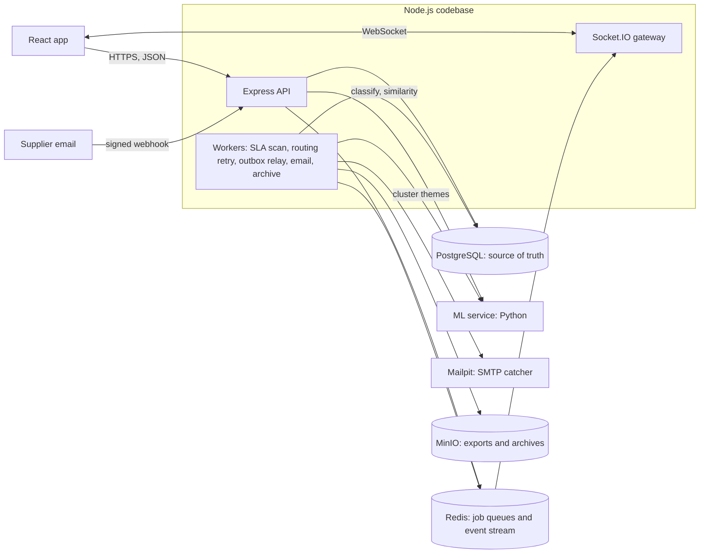
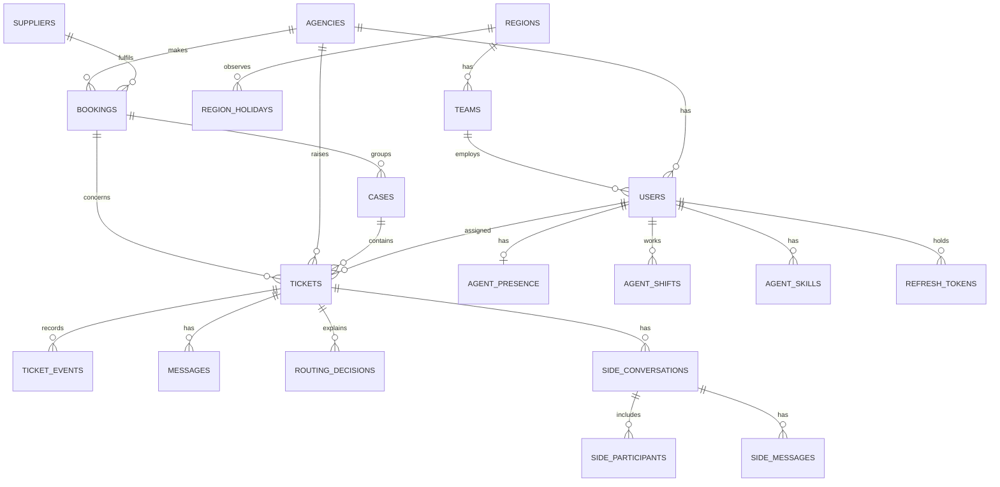

# OpsDesk

A travel-aware operations ticketing system. Travel agencies raise tickets about hotel bookings, and support staff resolve them. Every ticket knows which booking it belongs to, so related contacts are grouped into one case, work is routed to the right agent, and deadlines follow the traveller's check-in date instead of a generic clock.

**Stack:** PostgreSQL, Express, React, Node (PERN), with Redis for queues and a small Python service for machine learning.

**Status:** Phase 0, design. This document is the plan; no application code exists yet. Every number below is a target or an estimate until a later phase replaces it with a measurement.

## Contents

1. [What OpsDesk is](#1-what-opsdesk-is)
2. [Goals and non-goals](#2-goals-and-non-goals)
3. [Requirements](#3-requirements)
4. [Capacity estimate](#4-capacity-estimate)
5. [Architecture](#5-architecture)
6. [Tech stack](#6-tech-stack)
7. [Data model](#7-data-model)
8. [Data integrity rules](#8-data-integrity-rules)
9. [Concurrency hazards](#9-concurrency-hazards)
10. [Key flows](#10-key-flows)
11. [Ticket state machine](#11-ticket-state-machine)
12. [Tenant isolation and security](#12-tenant-isolation-and-security)
13. [API design](#13-api-design)
14. [ML service boundary](#14-ml-service-boundary)
15. [Background work](#15-background-work)
16. [Observability](#16-observability)
17. [Testing strategy](#17-testing-strategy)
18. [Roadmap](#18-roadmap)
19. [Repository layout](#19-repository-layout)
20. [Trade-offs and scaling](#20-trade-offs-and-scaling)

---

## 1. What OpsDesk is

### The problem

A B2B travel platform sells hotel rooms to travel agencies. When something goes wrong (a booking is missing at the hotel, a refund has not arrived, a voucher shows the wrong dates) the agency contacts support. A generic helpdesk handles this badly in four ways:

- **Contacts are scattered.** The same agency emails three times about one booking and three different agents pick the tickets up, each without the others' context.
- **Urgency is wrong.** A ticket about a guest arriving tonight waits behind one about a stay three months away, because both are "normal priority".
- **Routing is manual.** A lead reads each ticket and assigns it by hand, with no record of why.
- **Supplier conversations break.** An agent emails the hotel, the ticket is moved to another team, and the hotel's reply goes nowhere.

### What "travel-aware" means

Each ticket is tied to a booking, identified by its booking reference (**TBOH**). Two dates on that booking drive everything:

| Term | Meaning | Why it matters |
|---|---|---|
| **Check-in** | The day the guest arrives at the hotel | After this, most problems can no longer be fixed |
| **LCD** (Last Cancellation Date) | The last moment the booking can be cancelled without a fee | After this, a mistake costs real money |

OpsDesk uses these to compute deadlines: a ticket must be answered before the booking's own deadline, not just within a fixed number of hours.

### Who uses it

| Role | Who | Can do |
|---|---|---|
| **Requester** | A user at a travel agency | Raise tickets, reply, see only their own agency's tickets and public replies |
| **Agent** | Support staff | Work tickets, write internal notes, talk to suppliers |
| **Escalation manager** | Senior support | Own escalated tickets, de-escalate |
| **Lead** | Team lead | Everything an agent can, plus reassignment, exports and insights |

---

## 2. Goals and non-goals

### Goals

- Treat a ticket as part of a **case**: every related contact on the same booking is visible together.
- **Route** tickets by region, shift, priority and agent load, and record the reason for each decision.
- Compute **SLA deadlines** from real travel urgency, and make escalation an explicit state change.
- Keep **side conversations** with suppliers correct when tickets move between teams.
- Serve **large exports** and near-real-time updates with no row caps.
- Enforce strict **tenant isolation**: an agency never sees another agency's data.
- Keep data **correct under concurrency**: no duplicate tickets, no lost edits, no agent over their limit.

### Non-goals

- Phone, WhatsApp or social intake. Email and a web form are enough.
- Production single sign-on, billing, or serving many separate companies.
- A large language model layer. Machine learning is limited to intent and theme classification.

### Assumptions

- One organisation runs OpsDesk; its customers are many agencies.
- Agent shifts and regional holiday calendars are seeded, not pulled from an HR system.
- OpsDesk issues its own login tokens. A real identity provider would replace this.
- Email is sent to a local mail catcher (Mailpit), so no real message leaves the machine.

---

## 3. Requirements

### Functional

| # | Requirement | Phase |
|---|---|---|
| F1 | Tickets carry agency, TBOH, intent, priority, check-in, LCD and region | 1 |
| F2 | New tickets link automatically to open or recent tickets on the same TBOH, or the same agency and intent | 2 |
| F3 | Intent is suggested on create; agents can override it, and overrides are logged | 2 |
| F4 | Status machine New, Open, Pending, Escalated, Resolved, Closed with guarded transitions | 1 |
| F5 | Every change appends to the ticket's timeline | 1 |
| F6 | Routing by region, shift window, priority and agent load, with a stored reason | 3 |
| F7 | Queue views: triage, my queue, by region, by intent, linked cases, escalations | 3 |
| F8 | Side conversations with explicit recipients that survive a transfer | 4 |
| F9 | Internal notes are never sent or shown to agencies | 1 |
| F10 | SLA deadline from priority, check-in and LCD proximity, and regional holidays | 3 |
| F11 | At-risk and breached flags on queues; automatic escalation on breach | 3 |
| F12 | Escalating to an escalation manager changes owner and queue | 3 |
| F13 | Weekly themes with counts and sample tickets | 5 |
| F14 | Streaming CSV export with no row cap, plus a cursor-paginated API | 5 |
| F15 | Archival of closed tickets after a retention window | 5 |
| F16 | Roles: requester, agent, escalation manager, lead | 1 |

### Non-functional targets

| Property | Target |
|---|---|
| Read latency | p95 under 150 ms at 50 requests per second on a laptop |
| Ticket create (classify, link, route included) | p95 under 300 ms |
| Export | 100,000 rows streamed in under 30 s with flat memory |
| Realtime | A state change reaches connected clients within 2 s |
| Correctness | No duplicate ticket from a retry; no lost update; no agent above their cap; no cross-agency read |
| Durability | A committed change is never lost, and its event is never silently dropped |
| Availability of create | Ticket create keeps working when the ML service, Redis or email is down |

---

## 4. Capacity estimate

Estimating first tells us which problems are real. The design load is **50,000 tickets per day**.

| Quantity | Working | Result |
|---|---|---|
| Average ticket writes | 50,000 / 86,400 s | about 0.6 per second |
| Peak ticket writes | 10 times average | about 6 per second |
| Timeline events | about 8 per ticket | 400,000 per day, about 146 million per year |
| Messages | about 4 per ticket | 200,000 per day, about 73 million per year |
| Tickets | 50,000 per day | about 18 million per year |
| Storage | tickets about 2 KB, messages about 1.5 KB, events about 0.4 KB, indexes included | roughly 200 GB per year before archival |
| Reads | 500 staff with open queues | tens of requests per second |

What this tells us:

- **Throughput is not the hard part.** A single PostgreSQL server handles thousands of simple writes per second. Six per second needs no sharding, no message broker cluster and no microservices.
- **Correctness is the hard part.** With hundreds of people and several background jobs touching the same tickets, the risk is two valid requests arriving at the wrong moment. Most of this design is about that.
- **Growth is in two tables.** Events and messages grow by over 200 million rows a year, so those two are partitioned by month and archived. Tickets stay small enough to index normally.
- **Reads dominate.** Queue views are read far more often than tickets are written, so indexes are designed around the queue queries, and paging never uses `OFFSET`.

---

## 5. Architecture

### Components



### Why a modular monolith

One Node codebase owns all writes, and PostgreSQL is the only source of truth. The API, the WebSocket gateway and the workers are separate processes started from the same code.

- **One transaction can cover everything that must change together**: the ticket, its timeline entry and the event that announces it. Split across services, that needs distributed coordination, for no gain at six writes per second.
- **The database does work that would otherwise be code**: foreign keys, check constraints, row locks and Row-Level Security.
- **Module boundaries are kept clean** (`domain`, `services`, `routes`, `workers`), so a part could be cut out into its own service later if it ever needed to scale alone.

The cost is one failure domain: a slow endpoint shares resources with fast ones. Slow work is therefore pushed to workers.

### What each part owns

| Part | Owns | Never does |
|---|---|---|
| Express API | Validation, permissions, all state changes, reads | Slow work inside a request (email, exports to file, clustering) |
| PostgreSQL | Every durable fact | Hold anything that only lives in memory elsewhere |
| Redis | Job queues, the event stream, rate-limit counters | Hold anything that cannot be rebuilt from PostgreSQL |
| Workers | Scheduled and queued work, each job safe to run twice | Bypass the service layer to change tickets |
| ML service | Answers about text | Touch the database or see credentials |
| Socket.IO gateway | Pushing events to browsers | Decide who may read; it applies the same rules as the API |

### Layers inside the API

```
routes/      parse the request, call one service function, shape the response
services/    the only place state changes: opens a transaction, applies rules, records events
domain/      pure functions: state machine, permissions, SLA maths, routing score (no I/O)
db/          table definitions and the transaction helper
```

A rule lives in exactly one layer. Pure rules in `domain/` are tested with no database at all, which keeps the test suite fast and the rules easy to reason about.

### What happens when a part fails

| Failure | Effect | Why it is safe |
|---|---|---|
| ML service down or slow | Ticket is created with intent `other` and flagged for review | The call has a short timeout and a circuit breaker; create never waits on it |
| Redis down | API keeps accepting writes; realtime updates and emails are delayed | Events wait in the `outbox` table and are published when Redis returns |
| Worker crashes mid-job | The job runs again | Every job is idempotent |
| Email server down | Sends are retried with backoff, then parked in a dead-letter table | The message itself is already saved |
| API process crashes mid-request | The transaction rolls back; the client retries with the same idempotency key | Nothing is half-written |
| PostgreSQL down | The system is down | It is the single source of truth by design; `/readyz` reports it |

---

## 6. Tech stack

| Concern | Choice | Why |
|---|---|---|
| Language | TypeScript on Node 22 | One language for API, workers and UI; types catch mistakes in request and row shapes |
| HTTP | Express 5 | Small and well understood; middleware fits auth, idempotency and rate limiting |
| Validation | Zod | One schema validates the request and generates the OpenAPI document |
| Database | PostgreSQL 16 | Transactions, constraints, row locks, Row-Level Security, partitioning, full-text search |
| Queries | `pg` with Drizzle ORM | Typed queries that stay close to SQL, with raw SQL where needed |
| Migrations | Plain SQL files, node-pg-migrate | Partitions, policies and grants need real SQL; a file per change is easy to review |
| Queues | Redis 7 with BullMQ | Retries, backoff, scheduled jobs |
| Events | Redis Streams | Ordered, replayable, consumer groups |
| Realtime | Socket.IO | Rooms map directly to "who may see this" |
| ML | Python, FastAPI, scikit-learn | The standard tools for TF-IDF, logistic regression and k-means |
| Email | Nodemailer to Mailpit | Real SMTP behaviour with nothing leaving the machine |
| Files | MinIO | S3-compatible storage for exports and archives |
| Frontend | React, Vite, TanStack Query | Server state with caching and refetching handled for us |
| Tests | Vitest, Supertest, Testcontainers, fast-check | Real PostgreSQL in tests; property tests for date maths |
| Observability | pino, prom-client, OpenTelemetry, Grafana | Logs, metrics and traces tied together by a request id |
| Load and contract | k6, Schemathesis | Measured latency; the API is checked against its own specification |
| Local infrastructure | Docker Compose | One command starts every dependency |

---

## 7. Data model

### Relationships



### Core tables (Phase 1)

| Table | Purpose | Keys and constraints worth knowing |
|---|---|---|
| `regions` | MEA, EU, APAC, AMER, each with a time zone | Primary key is the code; time zone is required because business hours depend on it |
| `agencies` | Customers | Unique `slug`; `is_active` instead of deletion |
| `teams` | Support teams, one region each | Foreign key to `regions` |
| `users` | Everyone who logs in | Unique lower-cased email; `role` restricted by `CHECK`; a requester **must** have an `agency_id` and staff **must not** (one `CHECK` across both columns); `is_active` instead of deletion |
| `suppliers` | Hotels and wholesalers | Unique `code` |
| `bookings` | One hotel booking | Unique `tboh`; foreign keys to agency and supplier; `check_in_date`, `hotel_time_zone`, `lcd_at`; `CHECK (lcd_at <= check-in)`; `amount numeric(12,2)` with `currency char(3)` |
| `cases` | A group of tickets about one booking | At most **one open case per booking**, enforced by a partial unique index |
| `tickets` | The unit of work | See below |
| `ticket_events` | Append-only timeline | Partitioned by month; no `UPDATE` or `DELETE` allowed for the application |
| `messages` | Public replies and internal notes | Partitioned by month; `visibility` is `public` or `internal`; append-only |
| `outbox` | Events waiting to be published | Written in the same transaction as the change; partial index on unpublished rows |
| `idempotency_keys` | One row per client retry key | Unique `(user_id, key)`; stores request hash, status and response body |
| `refresh_tokens` | Login sessions | Stores only a SHA-256 hash; `used_at` makes each token single-use |

### The `tickets` table

| Column group | Columns | Rule |
|---|---|---|
| Identity | `id` (UUID), `agency_id`, `booking_id`, `case_id`, `requester_id` | All foreign keys; `agency_id` must equal the booking's agency (composite foreign key) |
| Content | `subject`, `body` | Required, length-limited; a generated `search_vector` column feeds full-text search |
| Classification | `intent`, `intent_source`, `needs_review`, `priority` | Values restricted by `CHECK` |
| Workflow | `status`, `assignee_id`, `team_id` | `status` restricted by `CHECK`; a `new` ticket has no assignee |
| Travel copy | `check_in_at`, `lcd_at`, `region` | Copied from the booking at create so queues sort without a join |
| SLA | `sla_due_at`, `sla_state`, `sla_paused_at`, `sla_paused_total` | `sla_paused_at` is set only while status is `pending` |
| Lifecycle | `created_at`, `updated_at`, `resolved_at`, `closed_at` | `resolved_at` is set if and only if status is `resolved` or `closed` |
| Concurrency | `version` | Starts at 1, incremented by every update |

### Tables added later

| Phase | Tables |
|---|---|
| 2 | `intent_overrides`, `ticket_links` |
| 3 | `agent_shifts`, `agent_presence`, `agent_skills`, `routing_decisions`, `sla_policies`, `region_holidays`, `ticket_watchers`, `dead_letter_jobs` |
| 4 | `side_conversations`, `side_participants`, `side_messages`, `email_deliveries`, `inbound_emails`, `inbound_quarantine` |
| 5 | `theme_weekly`, `export_jobs`, `archive_manifests` |

A table is created in the phase that first uses it. Nothing is added "for later".

### Indexes follow the queries

| Query | Index |
|---|---|
| A queue ordered by deadline | `(team_id, sla_due_at)` restricted to live statuses (partial index) |
| My queue | `(assignee_id, sla_due_at)` restricted to live statuses |
| An agency's tickets, newest first, paged | `(agency_id, created_at DESC, id DESC)` |
| All tickets on a booking | `(booking_id)` |
| A ticket's timeline | `(ticket_id, created_at)` on each partition |
| Text search | GIN on `search_vector` |
| Unpublished events | Partial index on `outbox (id) WHERE published_at IS NULL` |

Partial indexes keep the hot indexes small: closed tickets are most of the table but are never in a queue.

### Design choices explained

- **UUID primary keys.** Ids appear in URLs. Sequential numbers would let anyone guess how many tickets exist and probe neighbours.
- **Normalised first, denormalised on purpose.** Bookings are the single home of travel dates. The ticket carries a copy only because queue sorting needs it, and bookings are not edited after import, so the copy cannot drift.
- **`agency_id` repeated on messages and events.** Row-Level Security policies can then check one column instead of joining. A composite foreign key `(ticket_id, agency_id)` to `tickets (id, agency_id)` makes it impossible for the copy to disagree with the ticket.
- **Partitioning by month** on the two tables that grow fastest. Queries for one ticket touch few partitions, and old months can be detached and archived as a unit instead of deleting rows one by one. The primary key is `(id, created_at)` because PostgreSQL requires the partition key in it. A default partition catches anything outside the created range.
- **Events are separate from messages.** Events are facts about what changed, used for audit and realtime. Messages are what people wrote. They have different readers and different visibility rules.

---

## 8. Data integrity rules

These are design rules, not aspirations. Each is enforced by the database where the database can do it, and each has a test. The aim is that an integrity audit of the finished system finds nothing.

### 8.1 Schema and relationships

- **Every reference is a real foreign key.** No "soft" ids pointing at rows that might not exist.
- **Every foreign key states its `ON DELETE` rule.** The default is `RESTRICT`: a row that others depend on cannot be removed. `CASCADE` is used only where the child has no meaning alone (session tokens of a user).
- **`NOT NULL` unless absence means something.** `assignee_id` may be null (unassigned). `subject` may not.
- **`CHECK` constraints for closed sets and cross-column rules**: status, priority, role, visibility; requester has an agency and staff do not; `lcd_at` is not after check-in; counters are not negative.
- **The server validates too**, with Zod, so users get clear errors. The database is the last line: it holds even if a script, a migration or a future service writes directly.

### 8.2 Duplicates, orphans and deletion

- **Unique constraints on natural keys**: user email (case-insensitive), booking `tboh`, supplier `code`, `(user_id, idempotency_key)`, one presence row per agent, one participant row per person per side conversation.
- **Uniqueness that depends on state uses partial unique indexes**: one open case per booking.
- **No hard deletes of business data.** The application's database role has no `DELETE` privilege on any business table. Users and agencies are deactivated with `is_active`. Tickets end in `closed`. Removal happens only through archival, which is a separate, audited job.
- **Orphans are impossible, not cleaned up**: foreign keys with `RESTRICT` and no deletes mean there is nothing to orphan.
- **Denormalised copies cannot disagree**, because composite foreign keys tie them to their source.

### 8.3 Transactions and concurrency

- **Every multi-step write is one transaction.** Creating a ticket writes the idempotency key, the ticket, the case link, the timeline event and the outbox row together, or none of them.
- **Lost updates are prevented by a `version` column** checked in the `WHERE` clause of every update.
- **Duplicate creates are prevented by idempotency keys** claimed inside the creating transaction.
- **Counters change only under a row lock**, in the same transaction as the fact they count, and are bounded by a `CHECK`. A nightly job recounts and reports any drift.
- **Queue pulls use `FOR UPDATE SKIP LOCKED`** so two workers never take the same row.
- **No external call happens inside a transaction.** Email, the ML service and Redis are called before or after, never while row locks are held.
- **Transactions are short.** A human never holds a lock: editing uses optimistic versioning.

Section 9 lists each race in detail.

### 8.4 Business rules

- **Status changes go through one transition table** on the server, used by every code path including background jobs.
- **The database backs the rules it can express**: allowed status values, `resolved_at` only in resolved or closed states, no assignee on a `new` ticket.
- **Nothing is enforced only in the browser.** The UI hides buttons for convenience; the server decides.
- **A failed write rolls back completely** and returns a typed error with a stable code. Database errors are mapped: unique violation to `409`, foreign key violation to `422`, serialization failure to a bounded retry.

### 8.5 Data types and time

- **All instants are `timestamptz`, stored in UTC.** `timestamp without time zone` is not used anywhere.
- **The server clock is the only clock.** `created_at` defaults to `now()` in the database. Client-supplied times are never trusted for ordering.
- **Calendar dates and instants are different types.** A check-in is a date at a hotel; it becomes an instant only with the hotel's time zone and a stated time of day. `lcd_at` is stored as an instant because it is a precise cut-off.
- **Business-hours maths converts explicitly** to the region's time zone, so shifts and holidays behave correctly across daylight-saving changes.
- **Ranges are half-open**: `created_at >= start AND created_at < end`. This removes the classic end-of-day and end-of-month boundary bugs, and matches how partitions are defined.
- **Money is `numeric(12,2)` with a currency code.** Floating point is never used for amounts.
- **Durations are stored as integers of seconds**, not as floats.

### 8.6 Migrations and maintainability

- **The schema changes only through numbered SQL migration files** in the repository. Nobody edits the database by hand.
- **Migrations are forward-only and never edited after they are merged.** A mistake is fixed by a new migration.
- **Two database roles.** Migrations run as the owner. The application runs as a role that owns nothing, cannot bypass Row-Level Security, and has only the privileges it needs.
- **Risky changes are done in safe steps**: add a column as nullable, backfill in batches, then add `NOT NULL`; create indexes with `CONCURRENTLY`; add constraints as `NOT VALID`, then validate.
- **Drift is detected**: CI builds a database from the migrations and compares it with the table definitions used by the code.
- **No dead structure**: a column or table with no reader is removed by a migration.
